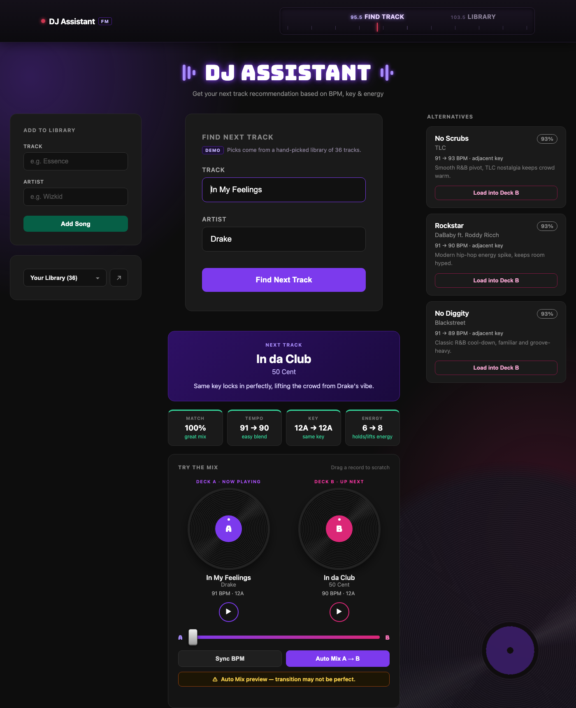

# DJ Assistant

Tell it the track you're playing and it picks the best next track from your library, based on **harmonic key** (Camelot wheel), **tempo** and **energy flow**. You can then hear the transition in a two-deck mixer in the browser.



## What it does

- **Next-track recommendation.** One main pick, three alternatives and a three-track set chain, each with a match score and a one-line reason.
- **Two-deck mixer.** Plays 30-second iTunes previews on two spinning decks. You can scratch the records, use the crossfader, sync the tempos, or hit **Auto Mix** for a beat-matched blend (bass swap on the downbeat, 16 beats). Any alternative can be loaded into Deck B.
- **Real BPM and key.** Tempo and key are measured from the audio rather than guessed (see below).
- **Your own library.** Add songs and they're looked up, measured and saved. Each visitor gets their own copy of the demo library.
- **Forgiving search.** Typos and slang ("save ur tears") get "Did you mean?" suggestions instead of a wrong match. If MusicBrainz is down, lookups fall back to iTunes.

## How it works

**1. Measure.** `audio_analysis.py` downloads a track's iTunes preview, decodes it with ffmpeg and analyses it with librosa:
- **Tempo:** onset tempogram, then a line fit through the beat times.
- **Key:** chromagram matched against the 24 Krumhansl-Kessler key profiles, then converted to Camelot notation.

Each value carries a confidence score. When I checked the seed library against measured audio, the LLM's original BPM guesses were right only 35% of the time (even counting half and double time), and none of its keys were exactly right. That's why the numbers now come from the audio. A few tracks whose swing rhythm fools the detector use published values instead, and these are labelled as such.

**2. Shortlist with rules.** `dj_logic.py` scores every library track against the current one in plain Python:
- **Key:** Camelot relationship (same key, relative major/minor, adjacent, +2 energy boost).
- **Tempo:** tempo difference, including half and double time.
- **Energy:** flow from one track to the next.

Tracks too far apart in tempo to beat-match are dropped.

**3. Let Claude choose and explain.** Claude picks from that shortlist **by ID** and writes the short "why". Its answer is then validated:
- Unknown or repeated tracks are replaced.
- Alternatives can't clash in key.
- Set-chain steps must be playable (no key clash, within 8% tempo).
- Every number on the page comes from the library, not from the model.

If the API is unavailable, a rule-based recommendation is shown instead.

**4. Mix in the browser.** The mixer uses the Web Audio API. It detects each preview's beat grid in the browser, time-stretches Deck B with key lock, and lines up the beats to within a few milliseconds before blending.

## Tech stack

- **Python / Flask:** web app and routes
- **librosa + ffmpeg:** BPM and key analysis
- **Anthropic Claude API:** choosing from the shortlist and writing the explanations
- **MusicBrainz + iTunes Search APIs:** song lookup, suggestions and preview clips
- **Vanilla JS + Web Audio API:** the two-deck mixer
- **pytest:** tests for the mixing rules, recommender validation, search and audio analysis
- **Docker / Railway:** deployment

## Running locally

You'll need Python 3.11+ and [ffmpeg](https://ffmpeg.org/) (`brew install ffmpeg` on macOS).

```bash
pip install -r requirements.txt
```

Create a `.env` file in the project root:

```
ANTHROPIC_API_KEY=sk-ant-...
SECRET_KEY=any-long-random-string
# Optional: how MusicBrainz can contact you (email or URL). Defaults to this repo.
MB_CONTACT=
```

You can generate a `SECRET_KEY` with:

```bash
python3 -c "import secrets; print(secrets.token_hex(32))"
```

Then start the app:

```bash
python3 app.py
```

Open [http://127.0.0.1:5000](http://127.0.0.1:5000). Set `PORT` to use a different port, e.g. `PORT=5001 python3 app.py`.

Run the tests with:

```bash
python3 -m pytest
```

## The library

The demo library is `library.json`, a hand-picked set of hip-hop and R&B tracks. Each track has a title, artist, BPM, Camelot key, energy (1–10), genre, a preview URL, and where the BPM and key came from (`audio` or `published`, with a confidence rating).

To re-measure every track from its audio and see how the stored values compare:

```bash
python3 scripts/analyse_library.py library.json            # report only
python3 scripts/analyse_library.py library.json --write    # also update the file
```

More detail on the design decisions is in [UPGRADE_NOTES.md](UPGRADE_NOTES.md).
